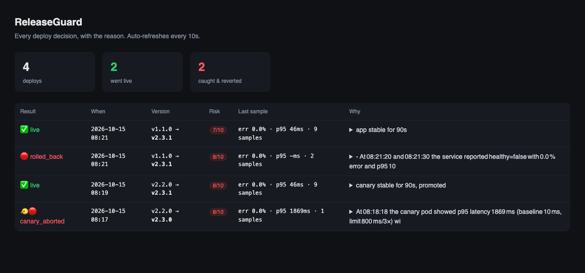

# ReleaseGuard

**An AI guardrail around deploys.** CI/CD gets code to production. ReleaseGuard watches what happens next, and undoes it when it goes wrong.

Before a deploy it reads the diff and scores the risk. During the deploy it runs the new version as a canary next to the stable pods. After the deploy it watches error rate, latency and pod health in Prometheus, and if the numbers move, it rolls back on its own and posts a plain-English explanation to Slack.


> The canary of `v2.3.0` pushed p95 latency from 10 ms to 1.8 s. ReleaseGuard removed the canary pod, left the stable pods untouched, and explained which lines caused it. Total time: 25 seconds, no human involved.

## Why

```
Friday 6:30 PM   Dev merges, pipeline is green, dev goes home.
Friday 7:10 PM   /checkout starts returning 500s. Nobody notices.
Friday 8:45 PM   A customer tweets. Founder calls the dev.
Friday 9:40 PM   Rollback done. 2.5 hours of downtime.
```

Every step in that story is manual work around the deploy, not the deploy itself. "Is this change risky?", "did the error rate move?", "should I roll back?", "what was the previous version?". ReleaseGuard automates exactly those steps.

## What it does

```
./rg deploy v2.3.0
         │
         ▼
 1. PRE-CHECK      git diff (running → new)  →  LLM  →  { score 1-10, reasons, flags }
         │
         ▼
 2. POLICY GATE    score ≥ 7, migration, env change  →  ask a human (Slack + terminal)
         │
         ▼
 3. CANARY         1 pod of the new version next to the stable pods (k8s)
         │         or a plain container swap (docker)
         ▼
 4. WATCH          every 10 s for 90 s, canary vs stable, from Prometheus:
                   5xx rate · p95 latency · pod restarts · readiness
         │
    ┌────┴─────┐
  stable     regression
    │           │
    ▼           ▼
 promote     discard canary / kubectl rollout undo
 to all      LLM writes the incident note from the numbers, the diff and pod logs
 pods        → Slack, → audit log
```

**The rollback decision is made by numbers, not by the model.** The LLM does two things only: score the diff before deploy, and write the explanation after a rollback. Thresholds live in `releaseguard.yml`.

## Scenarios it has caught

| Release | What was wrong | How it was caught | Outcome |
|---|---|---|---|
| `v2.0.0` | `coupon.percent` read without a null check, 30 % of checkouts throw | canary 5xx rate 22 % vs stable 0 % after 10 s | canary discarded, stable untouched |
| `v2.1.0` | new required env var not configured in the cluster | pods in `CrashLoopBackOff`, rollout never ready; pod logs read: `FATAL: PAYMENT_GATEWAY_URL is not set` | rolled back |
| `v2.3.0` | fraud check awaits a 1.5 s vendor call inside `/checkout` | canary p95 1869 ms vs baseline 10 ms (limit 800 ms) | canary discarded |
| `v2.2.0`, `v2.3.1` | nothing | 90 s stable on canary | promoted to all pods |

The pre-check flagged every one of the bad releases at 7-8/10 before anything was deployed, with the right reason.

## Dashboard



`./rg serve` shows every decision with the risk score, the last metrics sample and the full explanation. Everything is in a local SQLite file; `./rg history` prints the same in the terminal.

## CI

`.github/workflows/precheck.yml` runs the pre-check on every pull request that touches the app and posts the score as a PR comment, so reviewers see the risk before they approve. The deploy/watch/rollback part runs wherever the cluster is reachable.

## Quick start

Requirements: Docker, Node 22+, a free [Groq](https://console.groq.com) key. For the Kubernetes target: `minikube` and `kubectl`.

```bash
git clone https://github.com/HardCoder404/releaseguard && cd releaseguard
cp .env.example .env            # add GROQ_API_KEY, optionally SLACK_WEBHOOK_URL
(cd releaseguard && npm install)

# Docker target (simplest)
scripts/deploy.sh v1.1.0                               # bring up shop-api + Prometheus
./rg deploy v2.0.0 --traffic --target docker           # watch it roll back

# Kubernetes target (canary)
minikube start --driver=docker --ports=30080:30080,30090:30090
kubectl apply -f k8s/
./rg deploy v2.3.0 --traffic                           # watch the canary get discarded
./rg deploy v2.3.1 --traffic                           # watch it get promoted
./rg serve                                             # dashboard on :4000
```

`--traffic` runs a small load generator so the metrics have something to show. Without it the watcher tells you the verdict is weak.

### Commands

| Command | What it does |
|---|---|
| `./rg deploy <tag> [--yes] [--traffic] [--target docker\|k8s] [--no-canary]` | the full guarded deploy |
| `./rg precheck <ref> <ref>` | risk analysis only, prints markdown (used by CI) |
| `./rg status` | what is running, current metrics |
| `./rg rollback` | manual rollback |
| `./rg history` / `./rg serve` | audit log, terminal or browser |

### Configuration

```yaml
# releaseguard/releaseguard.yml
target: k8s
k8s: { deployment: shop-api, namespace: default, canary: true }
precheck:
  risk_threshold: 7
  require_approval_if: [migration, env_change]
watch:
  window_seconds: 90
  interval_seconds: 10
  rollback_if:
    error_rate_above: 0.05
    p95_latency_above_ms: 800
    p95_latency_factor: 3        # or 3x the pre-deploy baseline
    health_failures: 2
    pod_restarts_above: 1
```

## How it is built

```
releaseguard/
├── shop-api/            demo app: Express + prom-client, the thing being deployed
├── infra/               docker-compose (app + Prometheus) for the docker target
├── k8s/                 Deployment, Service, canary Deployment, ConfigMap,
│                        Prometheus with kubernetes_sd (finds pods by label)
├── scripts/             build from a git tag, deploy / rollback / canary, traffic
├── releaseguard/src/
│   ├── cli.ts           the flow: precheck → gate → canary|deploy → watch → promote|revert
│   ├── precheck.ts      diff → heuristics + LLM → risk JSON
│   ├── policy.ts        threshold + hard rules
│   ├── metrics.ts       2 PromQL queries + health, scoped to canary or stable
│   ├── watch.ts         baseline vs now, the actual decision
│   ├── targets/         docker.ts, k8s.ts: same interface, different kubectl/docker calls
│   ├── explain.ts       numbers + diff + pod logs → incident note
│   ├── notify.ts        Slack webhook
│   ├── db.ts            SQLite audit log (node:sqlite, no native deps)
│   └── serve.ts         dashboard
└── .github/workflows/   pre-check on PRs
```

Stack: TypeScript, Node, Docker, Kubernetes (minikube), Prometheus, Groq (`openai/gpt-oss-120b`), Slack webhooks, SQLite. Zero paid services.

**Design notes**

- *Canary over rolling update.* A rolling update replaces all pods; if the new version is bad, users are already on it. A canary exposes roughly a third of traffic, and a bad canary is deleted rather than rolled back, so stable pods never change.
- *Scoped metrics.* Prometheus carries a `track` label (`stable` / `canary`) from the pod labels, so the watcher compares the canary to the stable pods side by side instead of to a global average that the stable pods would dilute.
- *Heuristics under the model.* File-name and diff patterns (migrations, `process.env`, lockfiles) set a floor on the score, so a risky change is never under-reported because the model had a bad day.
- *Rollout failures are a first-class path.* If the new pods never become ready, `kubectl rollout status` times out, ReleaseGuard reads the crashing pod's logs, undoes the rollout and includes the log line in the explanation.

## Limitations and next steps

- Single cluster, single deployment. Multi-service releases would need a dependency order.
- The canary share is "1 pod out of N", not a precise traffic percentage. A service mesh or ingress weights would make it exact.
- The LLM sees the diff of one folder. A real repo would need a path filter per service.
- No GitHub webhook that triggers the deploy itself; CI runs the pre-check, the deploy is a CLI call where the cluster is.

## Author

Prince Raj · [prince404.in](https://prince404.in) · [GitHub](https://github.com/HardCoder404) · [LinkedIn](https://linkedin.com/in/prince404)
